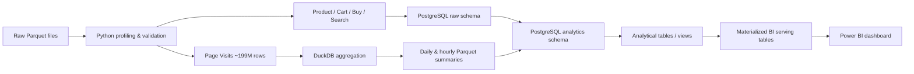

# Digital Product Analytics Platform
### User Behavior & E-commerce Intelligence

End-to-end data analytics portfolio project built from a large-scale real-world e-commerce behavior dataset.

The project covers data profiling, data quality investigation, large-volume processing, PostgreSQL modeling, SQL analytics, retention and conversion analysis, and Power BI reporting.

## Project objective

Build an analytics platform able to answer product and business questions such as:

- How many users visit the platform and how does traffic evolve?
- At what hours and on which weekdays is traffic highest?
- How many users add products to cart and eventually purchase?
- Which product categories convert best?
- Which products attract cart activity but underperform after cart?
- How strong is D1, D7 and D30 retention?
- How can a ~200M-row page-view dataset be processed efficiently without loading every raw row into PostgreSQL?

## Dataset

Source: Synerise RecSys Challenge 2025 dataset.

Main files used:

- `page_visit.parquet`
- `search_query.parquet`
- `add_to_cart.parquet`
- `remove_from_cart.parquet`
- `product_buy.parquet`
- `product_properties.parquet`

Approximate raw volumes:

| Dataset | Rows |
|---|---:|
| Page visits | 199,451,980 |
| Search queries | 13,223,769 |
| Add to cart | 7,541,117 |
| Remove from cart | 2,688,894 |
| Product purchases | 2,318,502 |
| Product properties | 1,534,050 |

Period observed: **2022-06-23 to 2022-12-08**.

> The final day is partial. It is excluded from selected visualizations where it would create an artificial drop.

## Architecture



## Technical stack

- **Python** — data profiling, validation and ingestion
- **Pandas** — data inspection and targeted analysis
- **PyArrow** — Parquet access
- **DuckDB** — efficient aggregation of the 199M-row page-view file
- **PostgreSQL 18** — warehouse and analytical model
- **psycopg** — PostgreSQL ingestion from Python
- **SQL** — transformations, funnel, product performance, retention and BI serving layer
- **Power BI** — interactive dashboard and reporting
- **DBeaver** — database exploration and SQL execution
- **VS Code** — development environment

## Data-quality decisions

### Repeated events

Exact repeated rows were detected in behavioral event files.

For example, `product_buy` contains **380,903 rows identified as duplicates by pandas**.

Instead of blindly deleting them, the analytical model groups identical events and preserves their frequency in:

`occurrence_count`

This avoids destroying potentially meaningful behavioral information.

### Product integrity

- Product catalog rows: **1,534,050**
- Unique SKUs: **1,534,050**
- Duplicate SKUs: **0**
- Unknown SKUs referenced by cart/purchase events: **0**

### Page-view strategy

Loading all **199,451,980 page-view rows** into PostgreSQL was unnecessary for the dashboard requirements.

DuckDB was used to aggregate the raw Parquet file into:

- `user_daily_activity` — 46,321,799 rows
- `hourly_traffic` — 4,033 rows

Both aggregates reconcile exactly to:

**199,451,980 page views**

This reduced storage and query cost while preserving the metrics required for analysis.

## PostgreSQL model

### `raw` schema

- `raw.product_properties`
- `raw.product_buy`
- `raw.add_to_cart`
- `raw.remove_from_cart`
- `raw.search_query`

### `analytics` schema

- `analytics.products`
- `analytics.product_events`
- `analytics.search_events`
- `analytics.user_daily_activity`
- `analytics.hourly_traffic`
- `analytics.product_performance`
- `analytics.user_first_activity`
- `analytics.retention_by_cohort`

Power BI serving tables:

- `analytics.bi_dashboard_kpis`
- `analytics.bi_daily_traffic`
- `analytics.bi_hourly_pattern`
- `analytics.bi_weekday_pattern`
- `analytics.bi_category_performance`
- `analytics.bi_product_opportunities`
- `analytics.bi_retention_by_cohort`

## Key business insights

### Traffic

- **21.99M** observed visitors
- **199.45M** page views
- **9.07** average page views per visitor
- **169** active days
- Peak traffic hour: **19:00**
- Highest-traffic weekday: **Sunday**
- Lowest-traffic weekday: **Saturday**

### Funnel

- Cart users: **2.33M**
- Buyers: **909K**
- Observed visit → cart rate: **10.44%**
- Observed visit → purchase rate: **2.91%**
- Chronological cart → purchase rate: **24.22%**

A key validation finding is that not every cart user or buyer appears in the page-view data. Therefore the 2.91% visit-to-purchase metric is explicitly described as an **observed conversion rate among users present in page-visit data**, not an absolute platform-wide conversion rate.

### Retention

For mature cohorts with sufficient observation time:

- **D1 retention:** 5.95%
- **D7 retention:** 2.31%
- **D30 retention:** 1.19%

### Product performance

The model calculates, by product and category:

- distinct users adding to cart
- buyers purchasing after cart
- cart-to-purchase conversion rate

This allows the dashboard to highlight both high-performing categories and high-interest products with weak post-cart conversion.

## Power BI dashboard

### Page 1 — Digital Product Analytics Overview

Contains:

- Visitors
- Page Views
- Cart Users
- Buyers
- Visit → Cart rate
- Visit → Purchase rate
- Daily Page Views
- Page Views by Hour
- Page Views by Weekday

### Page 2 — Conversion & Retention Analysis

Contains:

- D1 / D7 / D30 retention KPIs
- Retention by Cohort
- Top Categories by Conversion Rate
- Product Opportunities table

## Repository structure

```text
digital-product-analytics/
│
├── data/
│   ├── raw/                  # Not committed
│   └── processed/            # Not committed
│
├── python/
│   ├── 01_inspect_data.py
│   ├── 02_preview_data.py
│   ├── 03_check_special_columns.py
│   ├── 04_profile_metadata.py
│   ├── 05_check_products.py
│   ├── 06_check_duplicates.py
│   ├── 07_investigate_repeated_purchase.py
│   ├── 08_profile_repeated_events.py
│   ├── 09_check_timestamp_granularity.py
│   ├── 10_load_product_properties.py
│   ├── 11_load_event_tables.py
│   ├── 12_prepare_page_visits.py
│   └── 13_load_page_visit_summaries.py
│
├── sql/
│   ├── 01_create_raw_tables.sql
│   ├── 02_create_analytics_model.sql
│   ├── 04_create_page_visit_tables.sql
│   ├── 05_page_visit_validation.sql
│   ├── 06_traffic_analysis.sql
│   ├── 07_funnel_analysis.sql
│   ├── 08_funnel_validation.sql
│   ├── 09_product_performance.sql
│   ├── 10_retention_analysis.sql
│   ├── 11_dashboard_views.sql
│   └── 12_create_bi_tables.sql
│
├── dashboard/
│   └── digital_product_analytics.pbix
│
├── README.md
├── PROJECT_RECAP.md
└── .gitignore
```

## What this project demonstrates

- SQL analytics on large behavioral datasets
- PostgreSQL data modeling
- Python-to-database ingestion
- Parquet processing
- DuckDB for large-scale local analytics
- Data-quality investigation rather than blind cleaning
- Funnel analysis
- Retention/cohort analysis
- Product performance analysis
- BI modeling and dashboard design
- Business interpretation of technical results
