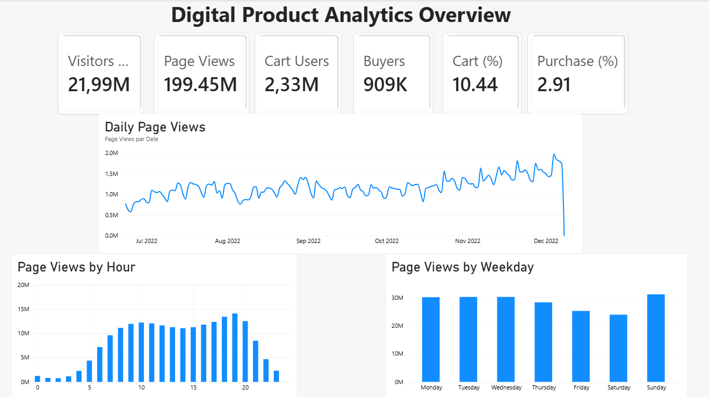
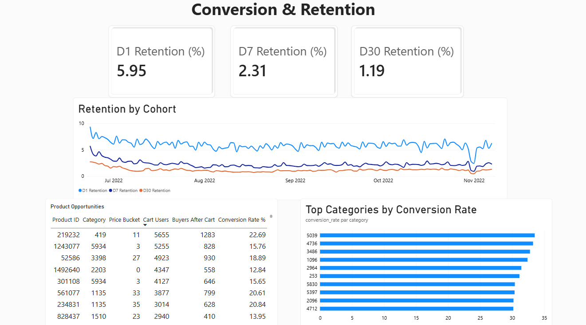
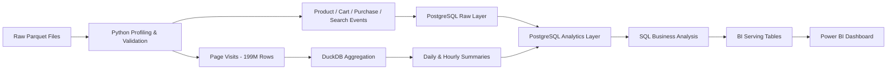

# Digital Product Analytics Platform

### E-commerce User Behavior, Conversion & Retention Analysis

End-to-end data analytics project built on a large e-commerce behavioral dataset from the **Synerise RecSys Challenge 2025**.

The objective was not only to build a dashboard, but to design the complete analytics flow behind it: understanding raw event data, validating data quality, processing large volumes efficiently, modeling the data in PostgreSQL, writing business-oriented SQL analyses, and exposing the final results through Power BI.

The dataset contains more than **200 million behavioral events**, including page visits, searches, cart activity and purchases.

---

## Dashboard Preview

### Digital Product Analytics Overview



### Conversion & Retention Analysis



The Power BI file is available in:

`Dashboard/digital_product_analytics.pbix`

---

## Project Goals

This project was designed to answer several product and business questions:

- How large is the observed user base and how does traffic evolve over time?
- At what hours and on which weekdays is traffic highest?
- How many users move from visit to cart and from cart to purchase?
- Which product categories convert best?
- Which products generate strong cart interest but weak purchase conversion?
- How strong is user retention at D1, D7 and D30?
- How should a dataset containing almost 200 million page views be processed efficiently?
- How can data-quality limitations be identified before interpreting conversion metrics?

---

## Key Results

| Metric | Result |
|---|---:|
| Observed visitors | 21.99M |
| Page views | 199.45M |
| Average page views per visitor | 9.07 |
| Cart users | 2.33M |
| Buyers | 909K |
| Observed Visit → Cart | 10.44% |
| Observed Visit → Purchase | 2.91% |
| Cart → Purchase after first cart | 24.22% |
| D1 Retention | 5.95% |
| D7 Retention | 2.31% |
| D30 Retention | 1.19% |

Additional findings:

- Traffic peaks around **19:00**
- **Sunday** has the highest page-view volume
- **Saturday** has the lowest page-view volume
- Several high-volume products generate significant cart activity but relatively weak purchase conversion
- Some buyers are not represented in the page-visit dataset, which affects how visit-to-purchase conversion should be interpreted

---

## Dataset

The project uses the behavioral dataset provided for the **Synerise RecSys Challenge 2025**.

Main source files:

| File | Rows |
|---|---:|
| `page_visit.parquet` | 199,451,980 |
| `search_query.parquet` | 13,223,769 |
| `add_to_cart.parquet` | 7,541,117 |
| `remove_from_cart.parquet` | 2,688,894 |
| `product_buy.parquet` | 2,318,502 |
| `product_properties.parquet` | 1,534,050 |

Observed period:

**2022-06-23 → 2022-12-08**

The final date contains only partial activity, so it was excluded from visualizations where it would otherwise create an artificial traffic drop.

The raw dataset is not included in this repository because of its size.

---

## Architecture



A key architectural decision was to avoid loading all **199 million page-view rows** into PostgreSQL when the dashboard did not require that level of detail.

Instead, DuckDB was used to query the Parquet file directly and generate the required aggregates before loading them into the analytical database.

---

## Tech Stack

| Technology | Usage |
|---|---|
| Python | Profiling, validation, ingestion and processing |
| Pandas | Data exploration and targeted quality analysis |
| PyArrow | Parquet inspection and access |
| DuckDB | Large-scale aggregation directly from Parquet |
| PostgreSQL 18 | Raw and analytical data model |
| SQL | Transformations and business analysis |
| psycopg | Python/PostgreSQL ingestion |
| Power BI | Dashboard and visualization |
| DBeaver | SQL development and database inspection |
| VS Code | Development environment |
| Git / GitHub | Version control and portfolio publication |

---

## Data Profiling & Quality Checks

Before building the analytical model, the source files were profiled to understand their structure and identify potential data-quality issues.

### Product integrity

The product catalog contains:

- **1,534,050 rows**
- **1,534,050 unique SKUs**
- **0 duplicated SKU**
- **0 unknown SKU** referenced by the main cart or purchase event datasets

This confirmed that event-level product references could be reliably joined to the product catalog.

### Repeated events

Exact repeated behavioral events were detected in several event datasets.

For example, `product_buy.parquet` contained:

**380,903 rows identified as duplicates by pandas**

Rather than applying a blind `drop_duplicates()`, repeated events were investigated first.

Because the timestamps showed unusual granularity and repeated events could potentially represent meaningful frequency, the analytical model preserves them through:

`occurrence_count`

The resulting event table therefore stores one analytical row per:

`client_id + event_time + sku + event_type`

while keeping the original number of occurrences.

This avoids losing information while still simplifying downstream analysis.

---

## Handling 199M Page Views

`page_visit.parquet` contains:

**199,451,980 rows**

Loading every page view into PostgreSQL would have increased storage and processing cost without improving the final analyses.

DuckDB was therefore used to aggregate the Parquet file directly into two analytical datasets.

### User Daily Activity

`analytics.user_daily_activity`

Contains:

- client
- activity date
- page-view count
- number of unique URLs
- first visit time
- last visit time

Rows:

**46,321,799**

### Hourly Traffic

`analytics.hourly_traffic`

Contains:

- traffic hour
- page views
- active users
- unique URLs

Rows:

**4,033**

Both aggregated datasets reconcile exactly to the original:

**199,451,980 page views**

This provided a validation check that no traffic volume was lost during aggregation.

---

## PostgreSQL Data Model

The database is separated into two main layers.

### Raw Layer

The `raw` schema contains minimally transformed source data.

Main tables:

- `raw.product_properties`
- `raw.product_buy`
- `raw.add_to_cart`
- `raw.remove_from_cart`
- `raw.search_query`

### Analytics Layer

The `analytics` schema contains business-ready structures.

Main tables:

- `analytics.products`
- `analytics.product_events`
- `analytics.search_events`
- `analytics.user_daily_activity`
- `analytics.hourly_traffic`
- `analytics.product_performance`
- `analytics.user_first_activity`
- `analytics.retention_by_cohort`

This separation keeps source ingestion independent from analytical transformations and makes the pipeline easier to debug and maintain.

---

## Traffic Analysis

The traffic analysis identified:

- **21,993,998 observed visitors**
- **199,451,980 page views**
- **9.07 average page views per visitor**
- **169 active days**

### Traffic by Hour

The strongest traffic occurs during the evening.

Peak hour:

**19:00 — 14.08M page views**

### Traffic by Weekday

| Day | Page Views |
|---|---:|
| Monday | 30.16M |
| Tuesday | 30.27M |
| Wednesday | 30.27M |
| Thursday | 28.34M |
| Friday | 25.28M |
| Saturday | 23.94M |
| Sunday | 31.19M |

Sunday records the highest traffic volume, while Saturday records the lowest.

---

## Conversion Funnel

Two funnel perspectives were calculated.

### Observed Visit Funnel

Among users represented in page-visit data:

- Visitors: **21.99M**
- Cart users: **2.30M**
- Buyers: **640K**

Conversion rates:

- Visit → Cart: **10.44%**
- Visit → Purchase: **2.91%**

### Cart → Purchase Funnel

A chronological analysis was also performed from each user's first cart event.

- Users with a cart event: **2,333,463**
- Users purchasing after their first cart: **565,203**

Result:

**24.22% Cart → Purchase conversion**

---

## Important Funnel Validation

One of the most important findings in the project came from validating event coverage across datasets.

The complete purchase dataset contains:

**909,210 buyers**

However:

**268,870 buyers do not appear in the page-visit dataset**

Similarly:

**38,156 cart users do not appear in the page-visit dataset**

This means the **2.91% Visit → Purchase** rate cannot be presented as a global platform conversion rate.

It is therefore explicitly defined as:

> Observed visit-to-purchase conversion among users represented in the page-visit dataset.

This distinction prevents an incorrect business interpretation of the source data.

---

## Product Performance

A product-level analytical table was created to calculate:

- number of users adding the product to cart
- number of users purchasing after cart
- cart-to-purchase conversion rate
- product category
- price bucket

This allows products with strong interest but weak conversion to be identified.

Example calculation:

```text
Cart Users = 5,655
Buyers After Cart = 1,283

Conversion Rate =
1,283 / 5,655 × 100
= 22.69%
```

The Power BI dashboard includes a **Product Opportunities** table focused on products with meaningful cart volume.

---

## Category Performance

Product conversion was also aggregated at category level.

To avoid ranking very small categories with unstable rates, category comparisons were filtered to categories with at least:

**1,000 cart users**

Some of the strongest categories observed were:

| Category | Cart → Purchase Rate |
|---|---:|
| 5039 | 33.51% |
| 4736 | 33.25% |
| 3486 | 32.77% |
| 1096 | 32.39% |
| 2964 | 31.42% |

The Power BI dashboard displays the top categories after applying this minimum-volume threshold.

---

## Retention Analysis

Users were assigned to a cohort based on their:

**first observed activity date**

Retention was then calculated as an exact return on:

- D1
- D7
- D30

For cohorts with enough future observation time:

| Retention Metric | Rate |
|---|---:|
| D1 | 5.95% |
| D7 | 2.31% |
| D30 | 1.19% |

Only mature cohorts were used for longer retention windows.

For example, a cohort near the end of the dataset cannot legitimately be assigned a D30 rate because 30 future days are not available.

---

## Power BI Serving Layer

The first Power BI implementation connected directly to analytical views.

Because some views required relatively expensive recalculation, this caused unstable PostgreSQL/OLE DB reads.

A lightweight BI serving layer was therefore created as physical PostgreSQL tables.

| Table | Rows |
|---|---:|
| `bi_dashboard_kpis` | 1 |
| `bi_daily_traffic` | 169 |
| `bi_hourly_pattern` | 24 |
| `bi_weekday_pattern` | 7 |
| `bi_category_performance` | 6,912 |
| `bi_product_opportunities` | 5,622 |
| `bi_retention_by_cohort` | 169 |

These tables contain precomputed analytical outputs derived from the complete dataset.

The purpose was to improve dashboard stability and performance, not to reduce the analytical scope.

---

## Power BI Dashboard

### Page 1 — Digital Product Analytics Overview

Main KPIs:

- Visitors
- Page Views
- Cart Users
- Buyers
- Visit → Cart
- Visit → Purchase

Visualizations:

- Daily Page Views
- Page Views by Hour
- Page Views by Weekday

### Page 2 — Conversion & Retention Analysis

Main KPIs:

- D1 Retention
- D7 Retention
- D30 Retention

Visualizations:

- Retention by Cohort
- Top Categories by Conversion Rate
- Product Opportunities

---

## Repository Structure

```text
digital-product-analytics/
│
├── python/
│   ├── 01_inspect_data.py
│   ├── 02_preview_data.py
│   ├── 03_check_special_columns.py
│   ├── 04_profile_metadata.py
│   ├── 05_check_products.py
│   ├── 06_check_duplicates.py
│   ├── 07_investigate_repeated_purchase.py
│   ├── 08_profile_repeated_events.py
│   ├── 09_check_timestamp_granularity.py
│   ├── 10_load_product_properties.py
│   ├── 11_load_event_tables.py
│   ├── 12_prepare_page_visits.py
│   └── 13_load_page_visit_summaries.py
│
├── sql/
│   ├── 01_create_raw_tables.sql
│   ├── 02_create_analytics_model.sql
│   ├── 03_validation_queries.sql
│   ├── 04_create_page_visit_tables.sql
│   ├── 05_page_visit_validation.sql
│   ├── 06_traffic_analysis.sql
│   ├── 07_funnel_analysis.sql
│   ├── 08_funnel_validation.sql
│   ├── 09_product_performance.sql
│   ├── 10_retention_analysis.sql
│   ├── 11_dashboard_views.sql
│   └── 12_create_bi_tables.sql
│
├── Dashboard/
│   └── digital_product_analytics.pbix
│
├── Screenshots/
│   ├── overview.png
│   └── conversion-retention.png
│
├── README.md
├── PROJECT_RECAP.md
└── .gitignore
```

The local project also contains:

```text
data/
├── raw/
└── processed/
```

These folders are intentionally excluded from GitHub through `.gitignore` because of the size of the source and generated datasets.

---

## Running the Project

The main execution flow is:

```text
1. Download the source Parquet files
2. Place them in data/raw/
3. Run the Python profiling scripts
4. Create the PostgreSQL database and schemas
5. Run the SQL scripts in numerical order
6. Load product and behavioral events into PostgreSQL
7. Aggregate page visits with DuckDB
8. Load page-view summaries into PostgreSQL
9. Run traffic, funnel, product and retention analyses
10. Create the BI serving tables
11. Connect Power BI to the analytics.bi_* tables
```

The raw dataset is not committed to this repository.

---

## Main Technical Decisions

Several decisions were made during the project based on the characteristics of the data rather than applying generic transformations:

**Preserve repeated events instead of blindly deleting them**  
Repeated event rows are aggregated into `occurrence_count`, preserving their frequency.

**Use DuckDB for the largest Parquet source**  
The 199M-row page-view file is aggregated directly from Parquet before PostgreSQL ingestion.

**Separate raw and analytical schemas**  
This keeps ingestion, transformation and business logic clearly separated.

**Validate source coverage before interpreting funnel metrics**  
The page-visit dataset does not contain every buyer, so visit-based conversion metrics are explicitly presented as observed metrics.

**Create a dedicated BI serving layer**  
Precomputed PostgreSQL tables provide a stable and lightweight interface for Power BI.

---

## What This Project Demonstrates

This project demonstrates practical experience with:

- large behavioral datasets
- data profiling and quality validation
- Python data processing
- Parquet files
- PostgreSQL data modeling
- SQL analytics
- DuckDB
- data ingestion
- funnel analysis
- cohort and retention analysis
- product analytics
- Power BI
- analytical performance optimization
- translating technical results into business insights

---

## Project Summary

The main challenge of this project was not simply producing visualizations, but deciding how to process, model and interpret a large behavioral dataset correctly.

The final solution combines:

**Python + DuckDB + PostgreSQL + SQL + Power BI**

to transform raw e-commerce events into an analytical platform covering traffic, conversion, retention and product performance.